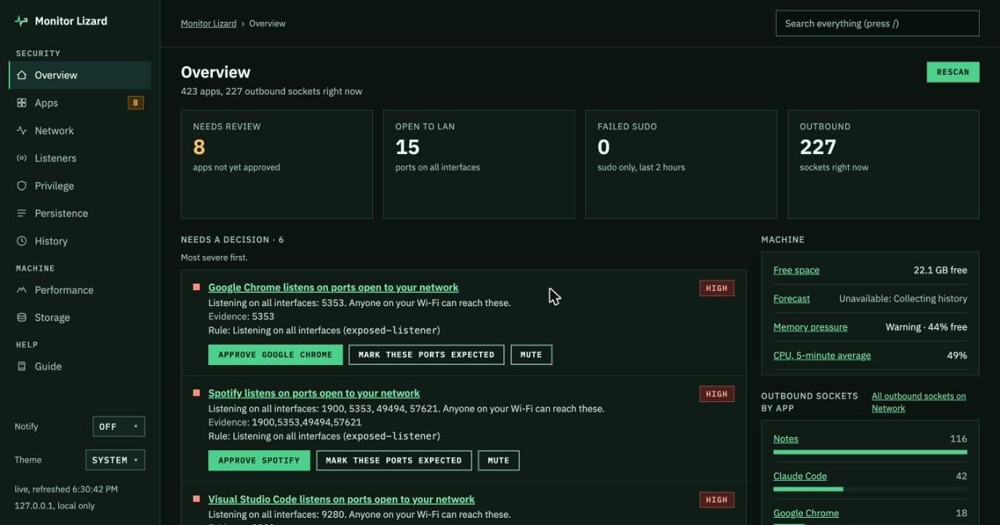
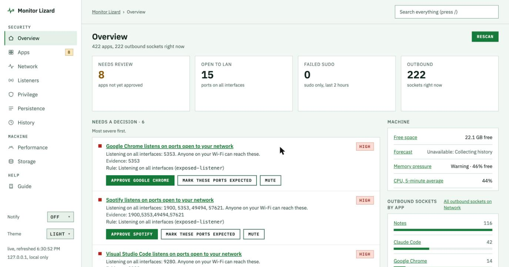

# Monitor Lizard

Local-first macOS monitor that groups every process and network socket by app and flags anything that is not yours.

<p align="center">
  
  
</p>

    cargo run --release              # grouped snapshot + findings
    cargo run --release -- serve          # dashboard at http://127.0.0.1:4747 (Stop/Quit need the per-run token the page carries)
    cargo run --release -- approve "/Applications/Notion.app"   # also: host:<app key>|<address>, startup:<plist path>, finding:<app key>:<rule>#<ports>
    cargo run --release -- json      # full snapshot as JSON
    cargo run --release -- privilege 60   # sudo/admin authorization requests, last 60 min
    cargo run --release -- watch          # live: catch every sudo/su launch with its parent chain
    cargo run --release -- sudo-log 20    # stored sudo/su launches
    cargo run --release -- model install --model qwen3-4b --yes   # downloads and verifies the local classifier model
    cargo test

State (baseline and history) lives in `~/.monitor-lizard/`; a one-time migration copies whichever of `~/.sys-monitor/` or `~/.ownwatch/` is found, the first time it finds no new folder.

The history database carries a schema version. The first time a build versions an older file it keeps an owner-only copy as `history.db.bak`, and a file from a newer build is refused rather than changed.

Turning on the `metrics_history` setting adds downsampled CPU/memory history to that same `history.db` (1 minute resolution for 48 hours, 15 minutes for 30 days; never per-process) -- off by default. Measured by filling both tiers to their full retention (23,048 rows: 2880 one-minute buckets plus 2880 fifteen-minute buckets, 4 metric columns each) and checking the resulting file size directly: about 753 KB after `VACUUM` (812 KB before it). The plan is [docs/plans/system-monitor.md](docs/plans/system-monitor.md).

Disk writes by app are off by default as well. Turn them on in the Storage page's "Disk writes by app" panel, which also has "Erase history". While the setting is on, `history.db` gets one row per app per hour: the app's name and the bytes its processes wrote. A row never holds a pid, a path or a file name, and rows older than 7 days are deleted. Only your own processes are counted: macOS lets only root read another user's process. App names with hourly counts reveal habits, so the rows never leave this Mac.

Marking an item as expected (the dashboard's "Mark expected" button, or `approve`) records it in `baseline.json` and in the history database, and stops it counting as new. A marked host or startup item keeps its row with an "expected" chip, and "Unmark" brings it back. The History page lists every mark and unmark.

A Tauri menu-bar shell (`src-tauri/`) runs the same server and dashboard in a window with a tray item, instead of a terminal and a browser tab. See [ADR 0004](docs/decisions/0004-tauri-menu-bar-shell.md) and "Building, signing and running the app locally" below.

## Commands

`monitor-lizard help [word]` lists every command and term, filtered by the word, with what each one changes and how to undo it. The dashboard serves the same table at `/api/guide`.

## Tables

Every table in the dashboard can export what is on screen as CSV or JSON (all filtered and sorted rows, shown columns only), choose its columns, and copy one row as JSON. Exports are built in the page and saved by your browser; nothing is sent anywhere. A file lists app names, hosts and paths, so share it with care.

The dashboard's Guide page shows the same table with search, topic filters and a glossary. It copies a command and never runs one.

## Building, signing and running the app locally

The CLI above (`cargo run --release -- serve`) needs no build step or signing. The Tauri menu-bar shell (`src-tauri/`) needs to be bundled, and -- to keep the Storage scanner's Full Disk Access grant across rebuilds -- signed with a stable Developer ID identity, not the default ad-hoc one. See [ADR 0004](docs/decisions/0004-tauri-menu-bar-shell.md) for why that gate exists.

Build and run, ad-hoc signed (the default: fine for trying it, but Gatekeeper still warns once per rebuild and any Full Disk Access grant does not survive the next one):

```sh
cargo install tauri-cli --locked          # once: installs the `cargo tauri` subcommand
cd src-tauri && cargo tauri build --bundles app
open "../target/release/bundle/macos/Monitor Lizard.app"   # the bundle lands in the workspace's target/, not src-tauri/target/
```

Sign with your own Developer ID instead, so a Full Disk Access grant keeps working after you rebuild:

```sh
security find-identity -v -p codesigning            # lists the exact identity strings on this Mac
codesign --force --options runtime \
  --sign "Developer ID Application: <your name> (<team id>)" \
  "../target/release/bundle/macos/Monitor Lizard.app"
codesign --verify --deep --strict "../target/release/bundle/macos/Monitor Lizard.app"   # confirms the signature took
open "../target/release/bundle/macos/Monitor Lizard.app"
```

Re-sign with the *same* identity string every time you rebuild -- a new identity, or no identity, loses any Full Disk Access grant you already added in System Settings. This needs an Apple Developer Program membership (99 USD/year) for the Developer ID Application certificate; notarization, for distributing the app outside your own Mac, is a separate step this repo does not yet automate (see [docs/agents/ci-and-release.md](docs/agents/ci-and-release.md)). Background and the owner's own Full Disk Access test are in the [Tauri shell spike report](docs/research/tauri-shell-spike/README.md).

## Working on this repo

Rules for people and AI agents are in [AGENTS.md](AGENTS.md). Work comes from the todo board (`make todos`), one todo per branch and pull request, each in its own git worktree. Run `make check` before pushing; CI runs the same targets and one `gate` check. Docs live in [docs/](docs/README.md). Structure adopted from the owner's `scaffold` template.

## Status and safety

macOS only, early. Read-only by default and local-only (binds 127.0.0.1). The dashboard can stop your own processes after a confirmation; it never signals root processes, launchd or itself, and every write needs a per-run token. On the Privilege page, you can freeze, resume, stop or force stop each process that led to a `sudo` or `su`, alone or with the chain below it. The server only signals your own processes, and only while the pid still has the recorded start time and program. It never signals root, launchd, Monitor Lizard or its parents and children. It continues only what it froze itself, never a process stopped by job control or a debugger. A preview and a single-use token come first. A shell, `login`, terminal app, editor or IDE, launcher or Claude hop needs a second confirmation. The server refuses those hops unless the request carries an explicit confirm flag; that is a deliberate extra step, not a security boundary, because anything holding the dashboard's token can send the flag. The page alone decides the warning wording and the caution level for scripts. A process that cannot be read is treated as your own session. History records each signal before it is sent. A frozen process stays frozen until you resume it. The command lines of a process's children are readable only with the dashboard's per-run token. The Storage route can move scanned folders to your Trash, never delete them. It takes ids from the last scan, re-checks each folder on disk, asks twice for anything labelled yours, and logs every move in History before it happens. The Storage page first shows a preview of what would move and why anything is refused. For a folder labelled yours it then asks again, naming the folder, and only after that moves anything. A single-use token ties the move to the exact preview you saw, and selecting something else clears it. Folders go to the Trash, but Finder's "Put Back" may not be offered for them; History keeps each original path so you can move one back by hand. No telemetry, and no network calls except `monitor-lizard model install`, which only ever contacts Hugging Face for the one pinned file it was told to fetch. The dashboard's type is bundled (IBM Plex Sans and Mono), so it looks the same whether or not those fonts are installed; see [THIRD-PARTY-NOTICES.md](THIRD-PARTY-NOTICES.md).

## License

MIT, see [LICENSE](LICENSE).
